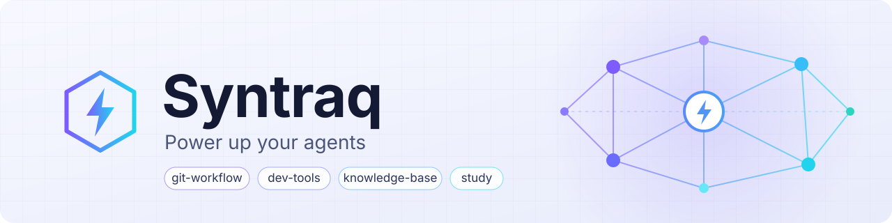

<picture>
  <source media="(prefers-color-scheme: dark)" srcset="assets/banner-dark.svg">
  
</picture>

# Syntraq

    

Marketplace de plugins para o [Claude Code](https://code.claude.com): skills que levam o agente do pedido à entrega — commits e pull requests com aprovação em cada passo, mudanças implementadas com registo escrito, knowledge bases mantidas por LLM e estudo para exames a partir dessa knowledge base.

Cada plugin instala-se à parte e tem o seu próprio README com a descrição completa de cada skill.

---

## Índice

- [Instalação](#instalação)
- [Plugins](#plugins)
- [Estrutura do repositório](#estrutura-do-repositório)
- [Contribuir](#contribuir)
- [Créditos](#créditos)
- [Licença](#licença)

---

## Instalação

Adiciona o marketplace uma vez e instala só os plugins que queres:

```text
/plugin marketplace add DiogoMMP/syntraq
/plugin install git-workflow@syntraq
/plugin install dev-tools@syntraq
/plugin install knowledge-base@syntraq
/plugin install study@syntraq
```

Para experimentar um plugin a partir de um clone local, sem o instalar:

```bash
claude --plugin-dir ./plugins/dev-tools
```

---

## Plugins

### [`git-workflow`](plugins/git-workflow/README.md) — Git & GitHub

| Skill | O que faz |
| :--- | :--- |
| `commit-push` | Cria commits (Conventional Commits) e faz push, seguindo GitFlow |
| `create-pr` | Abre um pull request preenchendo o template do repositório (ou um template por defeito, se não houver) |

### [`dev-tools`](plugins/dev-tools/README.md) — Desenvolvimento

| Skill | O que faz |
| :--- | :--- |
| `implement-change` | Implementa uma feature, bugfix ou hotfix ponta a ponta, com registo escrito |
| `create-readme` | Escreve ou reescreve o README.md raiz no formato da casa |
| `create-agents-md` | Escreve ou atualiza o `AGENTS.md` do repositório, em conjunto contigo |
| `clean-architecture` | Cria (ou reorganiza) um projeto em Clean Architecture |
| `write-tests` | Escreve testes unitários e/ou de integração, em qualquer stack |

### [`knowledge-base`](plugins/knowledge-base/README.md) — Knowledge base pessoal

| Skill | O que faz |
| :--- | :--- |
| `knowledge-base` | Cria a estrutura de pastas de uma knowledge base pessoal |
| `compile-wiki` | Compila/atualiza a `wiki/` a partir de notas e do git |
| `capture-note` | Grava rapidamente uma nota solta em `notes/` |
| `adr-new` | Cria uma nota ADR de decisão arquitetural |
| `resume` | Briefing para retomar um projeto pessoal parado |
| `wiki-lint` | Health check da `wiki/` (links partidos, órfãos, etc.) |

### [`study`](plugins/study/README.md) — Estudo

| Skill | O que faz |
| :--- | :--- |
| `exam-map` | Mapeia o que sai nos exames de uma cadeira |
| `study-summary` | Escreve um resumo completo para imprimir, em Word e PDF |
| `mock-exam` | Cria simulados de exame com enunciado e correção separados |
| `solve-exam` | Resolve exames e fichas só com a matéria da cadeira |
| `correct-attempt` | Corrige as tuas tentativas e regista os pontos fracos |
| `quiz` | Tutor no chat que te faz perguntas, focado nos pontos fracos |
| `flashcards` | Cria flashcards para o Anki |
| `study-plan` | Faz o plano de estudo, dia a dia, até aos exames |

---

## Estrutura do repositório

```
syntraq/
├── .claude-plugin/marketplace.json   # o catálogo: nome do marketplace e a lista de plugins
├── assets/                           # banner do README (versões clara e escura)
└── plugins/
    └── <plugin>/
        ├── .claude-plugin/plugin.json   # nome, descrição e versão do plugin
        ├── README.md                    # as skills do plugin em detalhe
        ├── skills/<skill>/SKILL.md      # cada skill, com templates/ ou reference/ quando precisa
        └── scripts/                     # scripts partilhados pelas skills (só no study)
```

---

## Contribuir

- **Branches** — nada vai diretamente para a `main`: cada trabalho vive numa `feature/<slug>` e entra por pull request (`create-pr`).
- **Commits** — Conventional Commits em inglês, com o tipo e o plugin no scope: `feat(study): add mock-exam…`, `fix(knowledge-base): …`.
- **Versões** — cada plugin tem a sua, em `plugins/<plugin>/.claude-plugin/plugin.json`, e sobe num commit `chore(release): bump <plugin> to X.Y.Z` à parte (`commit-push` trata disso).
- **Validação** — antes de um commit, `claude plugin validate ./plugins/<plugin>` e `claude plugin validate .` para o marketplace.

---

## Créditos

- O plugin [`knowledge-base`](plugins/knowledge-base/README.md) segue o fluxo `raw/` → `wiki/` compilado por LLM descrito por [Andrej Karpathy](https://x.com/karpathy/status/2039805659525644595) na nota ["LLM Knowledge Bases"](https://gist.github.com/karpathy/442a6bf555914893e9891c11519de94f).
- [`implement-change`](plugins/dev-tools/README.md) — créditos a [@michelgomessilva](https://github.com/michelgomessilva).

---

## Licença

MIT — ver [`LICENSE`](LICENSE).
